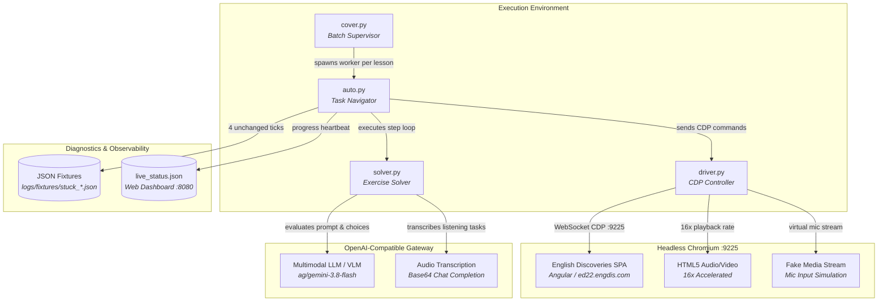

# Engdis Autopilot

Automated browser testing and exercise solver harness for English Discoveries courseware via Chrome DevTools Protocol (CDP) and multimodal LLMs.

> **Recommended**: Use **Docker Compose**. Packages Chromium with required audio codecs, fake media streams, and memory limits out of the box.

---

## Quickstart

### 1. Setup
```bash
cp .env.example .env
# Set credentials (ED_USER, ED_PASS) and LLM config (OPENAI_API_KEY, OPENAI_BASE_URL, OPENAI_MODEL) in .env

docker compose build
```

### 2. Run
```bash
# Docker Compose (preferred)
ED_COURSE="<COURSE>" ED_UNITS="<UNITS>" ED_DRY_RUN=0 docker compose run --rm engdis
ED_COURSE="<COURSE>" ED_UNITS="<UNITS>" ED_PASSES=2 ED_DRY_RUN=0 docker compose run --rm engdis

# Long-running inspect container (engdis_inspect)
docker exec engdis_inspect python3 -u cover.py <UNITS> 2 --course="<COURSE>"               # Autonomous yield mode (rc=6 on stalls)
docker exec engdis_inspect python3 -u cover.py <UNITS> 2 --course="<COURSE>" --unattended  # Unattended mode (skips stalls, keeps running)
docker exec engdis_inspect python3 cover.py <UNIT_IDX> 1 --course="<COURSE>" --test-only
```

---

## Delegating to AI Agents

Compatible with [Agent Skills](https://agentskills.io) (Claude Code, Cursor, Copilot, Hermes, Codex, OpenClaw).
See [CONTRIBUTING.md](CONTRIBUTING.md) for contribution guidelines, agent workflows, and offline reproducer steps.

<details open>
<summary><b>Example Prompts</b> (click to collapse)</summary>

- **Unattended Background Run**:
  > `/engdis-autopilot Run background supervisor for course "<COURSE>", units "<UNITS>", 2 passes. Run inside Docker, minimize chat interactions, and report final completion.`
- **Fix Stalled Tasks from Fixture**:
  > `/engdis-autopilot Autopilot stalled on a lesson. Inspect latest JSON in logs/fixtures/stuck_*.json. Check DOM HTML and task type, patch solver.py or auto.py, and verify with tests.`
- **Targeted Single-Lesson Test**:
  > `/engdis-autopilot Re-run failing test in unit <UNIT_IDX>, lesson "<LESSON_NAME>" with --test-only inside Docker. Confirm exit code 0.`

*Syntax tips: `/engdis-autopilot` is default for Claude Code, Copilot, and Cursor Agent Mode. If your harness prefers mentions or file tags, `@engdis-autopilot`, `$engdis-autopilot`, or `@skills/engdis-autopilot/SKILL.md` also work.*
</details>

<details>
<summary><b>Agent Operating Protocol</b> (click to expand)</summary>

1. **Background Batch**: Launch `cover.py` in background to prevent chat context token burn.
2. **Autonomous Yield Protocol (`rc=6`)**: When an exercise stalls (4 unchanged ticks), `auto.py` dumps fixture JSON + screenshot to `logs/fixtures/stuck_*.json`, emits `[AGENT-ACTION-REQUIRED]` to `stderr`, and exits with `rc=6`. The supervisor propagates `rc=6` and terminates immediately to wake the agent.
3. **Unattended Execution Mode**: Pass `--unattended` or set `ED_UNATTENDED=1` for headless overnight runs without an agent. Stalls will still dump fixtures but log a warning, skip the stalled task, and continue the batch without exiting.
4. **Targeted Fix**: Isolate fix with `--lesson="..."`, `--step="..."`, or `--test-only`.
5. **Test Gate**: Run `python3 -m unittest discover -s tests` before pushing.
</details>

---

## Architecture



---

## Features

- **CDP Automation**: Direct DOM instrumentation, interaction simulation, and navigation over Chrome DevTools Protocol.
- **Multimodal LLM Solvers**: Solves text, multiple-choice, fill-in-the-blank, and drag-and-drop tasks using OpenAI-compatible endpoints.
- **Unified Audio Transcription**: Transcribes listening exercises via base64 audio chat completions—no separate Whisper service needed.
- **Low-RAM Containment**: Strict container limits (1280 MB RAM, 256 MB SHM) and Chromium heap capping for low-spec hosts.
- **Dual Execution Modes**: Autonomous Agent Yield mode (`rc=6` on stalls) for interactive agent pairing, plus Unattended mode (`--unattended` / `ED_UNATTENDED=1`) for headless non-blocking runs.

---

## Project Structure

<details>
<summary><b>Repository Layout</b> (click to expand)</summary>

```
├── cover.py               # Supervisor and lesson batch runner
├── auto.py                # Task runner, stage detector, DOM navigator
├── solver.py              # LLM prompt builder and answer extractor
├── driver.py              # CDP connection, tab control, network instrumentation
├── login.py               # Auth handler and session recovery
├── asr.py                 # Audio extraction and base64 transcription client
├── poll.py                # Predicate polling and backoff utilities
├── bootstrap_browser.py   # Headless Chromium launcher with CDP health polling
├── compose.yaml           # Container definition with resource limits
├── Dockerfile             # Debian Bookworm container image with Chromium & FFmpeg
├── AGENTS.md              # AI coding agent operational patterns, failure modes & cheat-sheet
├── skills/
│   └── engdis-autopilot/  # In-repo operational skill (SKILL.md)
├── docs/                  # Detailed configuration, architecture, and auth guides
└── tests/                 # Unit and container test suite
```
</details>

---

## Documentation

- [Configuration Reference](docs/configuration.md) — All environment variables and LLM options.
- [Authentication Setup](docs/authentication.md) — Credential files and environment variable formats.
- [Architecture & Execution](docs/architecture.md) — Unattended vs. progressive patching and memory limits.
- [Diagnostic Dashboard](docs/dashboard.md) — Real-time web UI, screenshot stream, and JSONL events.

---

## Testing

```bash
# Local test suite
python3 -m unittest discover tests

# Containerized test suite
docker run --rm --entrypoint python3 engdis-autopilot:test -m unittest discover tests
```

---

## Safety & License

- **Safety & Ethics**: Review [SAFETY.md](SAFETY.md) and [SECURITY.md](SECURITY.md) before use.
- **License**: [MIT License](LICENSE) © 2026 Nguyễn Văn Trãi.
