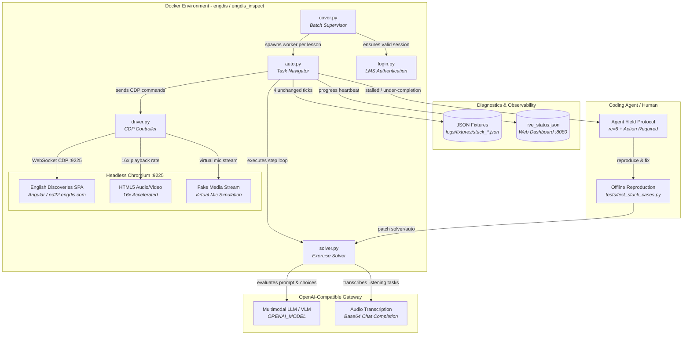

# Engdis Autopilot

Automated browser testing and exercise solver harness for English Discoveries courseware via Chrome DevTools Protocol (CDP) and multimodal LLMs.

> **Recommended**: Use **Docker Compose**. Packages Chromium with required audio codecs, fake media streams, and memory limits out of the box.

---

## Quickstart

### 1. Setup
```bash
cp .env.example .env
# Set credentials (ED_USER, ED_PASS) and LLM config (OPENAI_API_KEY, OPENAI_BASE_URL, OPENAI_MODEL) in .env

docker compose build
```

#### Recommended Free Providers (Zero-Cost Setup)

Pair **AnyRouter** (free reasoning router) with **Groq** (sub-second Whisper transcription) for an optimal, completely free setup:

| Service | Role | Configuration | Where to Get API Key |
| :--- | :--- | :--- | :--- |
| **AnyRouter** *(Recommended)* | Text / MCQ / Writing reasoning | `OPENAI_BASE_URL=https://anyrouter.dev/api/v1`<br/>`OPENAI_MODEL=anyrouter/free` | Sign up & create key at [anyrouter.dev/keys](https://anyrouter.dev/keys) |
| **Groq Whisper** *(Recommended)* | Listening audio STT (~0.5s) | `GROQ_API_KEY=gsk_...`<br/>`GROQ_WHISPER_MODEL=whisper-large-v3-turbo` | Free API key at [console.groq.com/keys](https://console.groq.com/keys) |
| **Google AI Studio** *(Alternative)* | All-in-one text + audio | `OPENAI_BASE_URL=https://generativelanguage.googleapis.com/v1beta/openai/`<br/>`OPENAI_MODEL=gemini-3.8-flash` | Free key at [aistudio.google.com](https://aistudio.google.com/) (15 RPM cap) |
| **OpenRouter** | Fallback text reasoning | `OPENAI_BASE_URL=https://openrouter.ai/api/v1`<br/>`OPENAI_MODEL=google/gemini-2.0-flash-exp:free` | Free models (`:free`) at [openrouter.ai/keys](https://openrouter.ai/keys) |

## Running with AI Agents

Compatible with Claude Code, Cursor, Copilot, Hermes, and Codex via [Agent Skills](https://agentskills.io).

Copy-paste these prompts into your agent chat:

- **Run Specific Unit, Lesson, or Range**:
  > `/engdis-autopilot Run unit 2 lesson "News" in course "Advanced 2" inside Docker.`  
  > `/engdis-autopilot Run units 0-4 in course "Advanced 3" inside Docker.`

- **Unattended Mode (Non-Stop Overnight)**:
  > `/engdis-autopilot Run unattended for course "Advanced 2" units 0-9. Skip stalls and finish the batch without waiting for input.`

- **Agent Yield Mode (Auto-Patch Stalls)**:
  > `/engdis-autopilot Run course "Advanced 2" unit 5 in agent mode. If stalled (rc=6), inspect the fixture in logs/fixtures/, patch solver.py, and resume.`

---

## Manual Execution (CLI Fallback)

If running without an AI agent:

> **Important**: The harness defaults to **Agent Yield mode** (halts on stalls with `rc=6` for an agent to fix). For manual non-stop execution, always add `--unattended` (or `ED_UNATTENDED=1`) so it skips stalls and finishes the run.

```bash
# Docker Compose (unattended non-stop run)
ED_COURSE="Advanced 2" ED_UNITS="0-9" ED_UNATTENDED=1 ED_DRY_RUN=0 docker compose run --rm engdis

# Targeted unit/lesson via container
docker exec engdis_inspect python3 cover.py 0-9 2 --course="Advanced 2" --unattended  # Recommended: skips stalls
docker exec engdis_inspect python3 cover.py 2 1 --course="Advanced 2" --lesson="News" --unattended
docker exec engdis_inspect python3 cover.py 5 1 --course="Advanced 2"  # Agent mode: exits rc=6 on stall
```

---

## Architecture



---

## Features

- **Docker-Enforced CDP Automation**: Direct DOM instrumentation, interaction simulation, and navigation over Chrome DevTools Protocol inside isolated containers.
- **Multimodal LLM Solvers**: Solves text, multiple-choice, fill-in-the-blank, and drag-and-drop tasks using OpenAI-compatible endpoints (`OPENAI_MODEL`).
- **Unified Audio Transcription**: Transcribes listening exercises via base64 audio chat completions—no separate Whisper service needed.
- **Low-RAM Containment**: Strict container limits (1280 MB RAM, 256 MB SHM) and Chromium heap capping for low-spec hosts.
- **Dual Execution Modes**: Autonomous Agent Yield mode (`rc=6` on stalls) for interactive agent pairing, plus Unattended mode (`--unattended` / `ED_UNATTENDED=1`) for headless non-blocking runs.
- **Offline Reproducer Protocol**: Exercises that stall dump DOM/compState fixtures, enabling offline unit testing without burning LLM tokens or touching live accounts.

---

## Project Structure

<details>
<summary><b>Repository Layout</b> (click to expand)</summary>

```
├── cover.py               # Supervisor and lesson batch runner
├── auto.py                # Task runner, stage detector, DOM navigator
├── solver.py              # LLM prompt builder and answer extractor
├── driver.py              # CDP connection, tab control, network instrumentation
├── login.py               # Auth handler and session recovery
├── asr.py                 # Audio extraction and base64 transcription client
├── poll.py                # Predicate polling and backoff utilities
├── bootstrap_browser.py   # Headless Chromium launcher with CDP health polling
├── compose.yaml           # Container definition with resource limits
├── Dockerfile             # Debian Bookworm container image with Chromium & FFmpeg
├── CONTRIBUTING.md        # Contribution guide, offline testing protocol & PR gates
├── AGENTS.md              # AI coding agent operational patterns, failure modes & cheat-sheet
├── .agents/skills/
│   └── engdis-autopilot/  # Canonical agent skill (SKILL.md)
├── docs/                  # Detailed configuration, architecture, and auth guides
└── tests/                 # Unit and offline fixture test suite
```
</details>

---

## Documentation

- [Configuration Reference](docs/configuration.md) — All environment variables and LLM options.
- [Authentication Setup](docs/authentication.md) — Credential files and environment variable formats.
- [Architecture & Execution](docs/architecture.md) — Unattended vs. progressive patching and memory limits.
- [Diagnostic Dashboard](docs/dashboard.md) — Real-time web UI, screenshot stream, and JSONL events.

---

## Testing

```bash
# Local test suite
python3 -m unittest discover tests

# Containerized test suite
docker run --rm --entrypoint python3 engdis-autopilot:test -m unittest discover tests
```

---

## Safety & License

- **Safety & Ethics**: Review [SAFETY.md](SAFETY.md) and [SECURITY.md](SECURITY.md) before use.
- **License**: [MIT License](LICENSE) © 2026 Nguyễn Văn Trãi.
