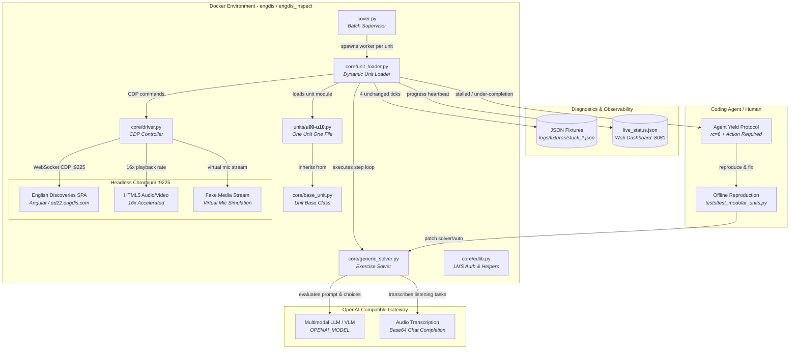

# Engdis Autopilot

Automated browser testing and exercise solver harness for English Discoveries courseware via Chrome DevTools Protocol (CDP) and multimodal LLMs.

## Pick the right mode first

| You want to | Run | Why |
| :--- | :--- | :--- |
| Lessons and practice, including **unit lesson tests** (not graded) | **Docker** (`docker compose run engdis`) or local | Headless is fine; lesson-test outcomes only affect unit completion percentage |
| A **graded exam** — Assessment Center midterm/final | **Local visible browser**, exam opened by you, then `auto.py` on that page | `cover.py` cannot open it; monitor the DOM loop while the exam is active |

The graded path is [Graded exams](#graded-exams-assessment-center-midterms-and-finals);
everything else starts at [Quickstart](#quickstart).

---

## Graded exams: Assessment Center midterms and finals

The courseware's scored assessment is the **Assessment Center exam**
(midterm, final, placement). **Unit lesson tests are not graded** — they only move a
unit's completion percentage — and are covered
[further down](#unit-lesson-tests-not-graded).

### What works, and what does not

- **`cover.py` cannot open an exam.** Its navigation walks
  `.home__unitW` → `learningArea` → lesson; an Assessment Center exam is not a unit
  lesson, so there is nothing to target.
- **Once the exam is open, the widgets are the usual ones.** Questions render through
  the practice manager (`.prMCQ__qaSet`, the test pager,
  `.learning__submitTestLink`), which is why `auto.py` applies: it classifies tasks by
  DOM, not by lesson name.
- **This path is unverified in this repo.** The handoff report is not evidence of
  this branch's behavior; the test suite has no Assessment Center fixture.

### Procedure

**1. Start a visible browser** so you can monitor the question and score screens:

```bash
python3 bootstrap_browser.py --headed --profile ~/.ed-profile
```

If the exam has a speaking item, launch Chrome yourself instead: the bootstrap flags
include `--use-fake-device-for-media-stream` and a graded speaking answer can be
rejected.

```bash
"$CHROME_BIN" --remote-debugging-port=9225 --user-data-dir=~/.ed-profile \
  --no-sandbox --window-size=1400,1000 about:blank
```

**2. Confirm the session:**

```bash
python3 -c "import edlib, login; t = edlib.tab(); print(login.ensure_login(t), t.url)"
```

**3. Open the exam yourself** in that window and get to the first question. Do not
ask `cover.py` to find it.

**4. Run the loop against the open page, with the window in front of you:**

```bash
python3 auto.py 400        # max iterations; stop with Ctrl-C or the STOP file
python3 status.py          # lesson|step|task|total|flags, one line per check
```

**5. Watch for these and stop the run if you see them:**

- **Counter stuck** (`1 / 12` staying at `1`) with an empty question area → the item
  never loaded. Stop; do not submit.
- **A reminder/modal** — read it; it names what is still missing.
- **Score screen** — the submit fires on the last question. Read the score before the
  loop moves on.

**6. Stop cleanly:**

```bash
touch STOP
python3 tools/spikes/killpy.py auto.py
```

The score is already saved server-side. **A second submission replaces it — there is
no undo**, so never re-run an exam "to fix" a score, and never use `--force`.

## Unit lesson tests (not graded)

Lesson tests only feed the unit's completion percentage. Headless Docker is fine for
them; use `--headed` if you want to watch.

```bash
# <unit> is the 0-based unit index; 1 = one pass; this is NOT a graded exam
python3 cover.py <unit> 1 --course="Advanced 2" --lesson="<lesson name>" --step=Test
```

In Docker, the same run is `ED_COURSE="Advanced 2" ED_UNITS="<unit>" docker compose run --rm engdis`.

Keep two habits even here:

- **Agent Yield mode by default**, `--unattended` only when you accept that a stalled
  item is skipped.
- **Don't retake a lesson test that already passed** unless you mean to replace the
  percentage: no `--force`, no `--retest`, no chasing a low `--min-score`.

---

## Quickstart

> Running an **Assessment Center exam**? Read [Graded exams](#graded-exams-assessment-center-midterms-and-finals) first; Docker below is for lessons and coverage, not exams.

### 1. Setup
```bash
cp .env.example .env
# Set credentials (ED_USER, ED_PASS) and LLM config (OPENAI_API_KEY, OPENAI_BASE_URL, OPENAI_MODEL) in .env

docker compose build
```

#### Recommended Free Providers (Zero-Cost Setup)

Pair **Groq Whisper** (sub-second transcription) with a free text endpoint for a completely free setup:

| Service | Role | Configuration | Where to Get API Key |
| :--- | :--- | :--- | :--- |
| **Groq Whisper** *(Recommended)* | Listening audio STT (~0.5s) | `GROQ_API_KEY=gsk_...`<br/>`GROQ_WHISPER_MODEL=whisper-large-v3-turbo` | Free API key at [console.groq.com/keys](https://console.groq.com/keys) |
| **Google AI Studio** *(Alternative)* | All-in-one text + audio | `OPENAI_BASE_URL=https://generativelanguage.googleapis.com/v1beta/openai/`<br/>`OPENAI_MODEL=gemini-3.8-flash` | Free key at [aistudio.google.com](https://aistudio.google.com/) (15 RPM cap) |
| **OpenRouter** | Fallback text reasoning | `OPENAI_BASE_URL=https://openrouter.ai/api/v1`<br/>`OPENAI_MODEL=openrouter/free` | Free Models Router at [openrouter.ai/keys](https://openrouter.ai/keys) |

## Running with AI Agents

Compatible with Claude Code, Cursor, Copilot, Hermes, and Codex via [Agent Skills](https://agentskills.io).

Copy-paste these prompts into your agent chat:

- **Run Specific Unit, Lesson, or Range**:
  > `/engdis-autopilot Run unit 2 lesson "News" in course "Advanced 2" inside Docker.`  
  > `/engdis-autopilot Run units 0-4 in course "Advanced 3" inside Docker.`

- **Unattended Mode (Non-Stop Overnight)**:
  > `/engdis-autopilot Run unattended for course "Advanced 2" units 0-9. Skip stalls and finish the batch without waiting for input.`

- **Agent Yield Mode (Auto-Patch Stalls)**:
  > `/engdis-autopilot Run course "Advanced 2" unit 5 in agent mode. If stalled (rc=6), inspect the fixture in logs/fixtures/, patch solver.py, and resume.`

- **Unit lesson test (not graded)**:
  > `/engdis-autopilot Run the unit lesson Test step for course "Advanced 2", unit 2, lesson "News". This only changes the unit completion percentage; it is not an Assessment Center exam. Docker is fine.`

The first two prompts are for routine practice/coverage; `--unattended` means a stalled item is skipped. Do **not** use that prompt or mode for an Assessment Center exam.

---

## Manual Execution

### Docker (headless, practice and coverage work)

If running without an AI agent:

> **Important**: The harness defaults to **Agent Yield mode** (halts on stalls with `rc=6` for an agent to fix). For manual non-stop execution, always add `--unattended` (or `ED_UNATTENDED=1`) so it skips stalls and finishes the run.

```bash
# Docker Compose (unattended non-stop run)
ED_COURSE="Advanced 2" ED_UNITS="0-9" ED_UNATTENDED=1 ED_DRY_RUN=0 docker compose run --rm engdis

# Targeted unit/lesson via container
docker exec engdis_inspect python3 cover.py 0-9 2 --course="Advanced 2" --unattended  # Recommended: skips stalls
docker exec engdis_inspect python3 cover.py 2 1 --course="Advanced 2" --lesson="News" --unattended
docker exec engdis_inspect python3 cover.py 5 1 --course="Advanced 2"  # Agent mode: exits rc=6 on stall
```

### Local, headed browser (unit lesson tests — optional)

```bash
python3 bootstrap_browser.py --headed --profile ~/.ed-profile   # visible window, CDP on :9225
python3 -c "import edlib, login; t = edlib.tab(); print(login.ensure_login(t), t.url)"
python3 cover.py <unit> 1 --course="Advanced 2" --lesson="<lesson name>" --step=Test
```

This is still a **unit lesson test**, not an Assessment Center exam; it only affects
the unit completion percentage. Docker is also fine when you do not need to watch
the window. For a graded midterm/final, follow
[Graded exams](#graded-exams-assessment-center-midterms-and-finals).

---

## Architecture



---

## Features

- **Docker-Enforced CDP Automation**: Direct DOM instrumentation, interaction simulation, and navigation over Chrome DevTools Protocol inside isolated containers.
- **Multimodal LLM Solvers**: Solves text, multiple-choice, fill-in-the-blank, and drag-and-drop tasks using OpenAI-compatible endpoints (`OPENAI_MODEL`).
- **Unified Audio Transcription**: Transcribes listening exercises via base64 audio chat completions—no separate Whisper service needed.
- **Low-RAM Containment**: Strict container limits (1280 MB RAM, 256 MB SHM) and Chromium heap capping for low-spec hosts.
- **Dual Execution Modes**: Autonomous Agent Yield mode (`rc=6` on stalls) for interactive agent pairing, plus Unattended mode (`--unattended` / `ED_UNATTENDED=1`) for headless non-blocking runs.
- **Offline Reproducer Protocol**: Exercises that stall dump DOM/compState fixtures, enabling offline unit testing without burning LLM tokens or touching live accounts.

---

## Project Structure

<details>
<summary><b>Repository Layout</b> (click to expand)</summary>

```
├── cover.py               # Supervisor and lesson batch runner
├── auto.py                # Task runner, stage detector, DOM navigator
├── solver.py              # LLM prompt builder and answer extractor
├── driver.py              # CDP connection, tab control, network instrumentation
├── login.py               # Auth handler and session recovery
├── asr.py                 # Audio extraction and base64 transcription client
├── poll.py                # Predicate polling and backoff utilities
├── bootstrap_browser.py   # Headless Chromium launcher with CDP health polling
├── edlib.py               # Shared LMS helpers and tab/state utilities
├── core/                  # Modular runtime (unit loader, base classes)
│   ├── base_unit.py
│   └── unit_loader.py
├── units/                 # Per-unit handlers ("One Unit One File")
│   ├── a2/                # u00.py ... u09.py
│   └── a3/
├── compose.yaml           # Container definition with resource limits
├── Dockerfile             # Debian Bookworm container image with Chromium & FFmpeg
├── CONTRIBUTING.md        # Contribution guide, offline testing protocol & PR gates
├── AGENTS.md              # AI coding agent operational patterns, failure modes & cheat-sheet
├── .agents/skills/
│   └── engdis-autopilot/  # Canonical agent skill (SKILL.md)
├── docs/                  # Detailed configuration, architecture, and auth guides
└── tests/                 # Unit and offline fixture test suite
```
</details>

---

## Documentation

- [Configuration Reference](docs/configuration.md) — All environment variables and LLM options.
- [Authentication Setup](docs/authentication.md) — Credential files and environment variable formats.
- [Architecture & Execution](docs/architecture.md) — Unattended vs. progressive patching and memory limits.
- [Diagnostic Dashboard](docs/dashboard.md) — Real-time web UI, screenshot stream, and JSONL events.

---

## Testing

```bash
# Local test suite
python3 -m unittest discover tests

# Containerized test suite
docker run --rm --entrypoint python3 engdis-autopilot:test -m unittest discover tests
```

---

## Safety & License

- **Safety & Ethics**: Review [SAFETY.md](SAFETY.md) and [SECURITY.md](SECURITY.md) before use.
- **License**: [MIT License](LICENSE) © 2026 Nguyễn Văn Trãi.
